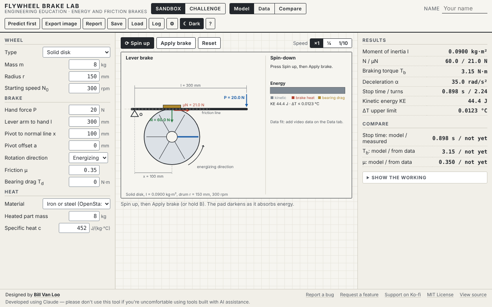

# Flywheel Brake Lab

A browser tool for modeling a spinning wheel and a lever-operated shoe brake. Students predict how the wheel stops, then bring in real timing data from slow-motion video and let the tool fit the slowdown. The tool works out the braking torque the data imply, the friction coefficient behind it, and where the energy went.

Part of **[Engineered by the Numbers](https://github.com/billvanloo/EngineeredByTheNumbers)**, a Principles of Engineering unit (module 3, the brake).



## Quick start

**Online:** open **https://billvanloo.github.io/FlywheelBrakeLab/** and share the link. GitHub Pages serves it from `main`, so every merge to `main` publishes within a minute or two.

**Offline:** download `index.html` and open it in any current browser. It's one self-contained file with no network calls, and works on a Chromebook.

## What students do

- **Model tab.**
  - Build the wheel: a solid disk, a thin hoop, a hub disk with a rim hoop, or a custom moment of inertia.
  - Set the lever: hand force P at distance l from the pivot, the shoe at distance x, the pivot's offset a from the friction line, the rotation direction, friction μ and bearing drag.
  - Press **Spin up**, then **Apply brake** (or hold B). The wheel slows at α = T / I at true speed, or at ¼ or 1/10 speed. The pad darkens and the energy bar shows kinetic energy turning into brake heat and bearing drag.
  - A lever that can't hold off the drum is shown as self-locking, with the reason.
- **Data tab.**
  - Paste or upload readings from a slow-motion video, in one of three formats: frame counts with the frame rate, time and turns, or the time each turn took.
  - The tool fits θ(t) = θ₀ + ω₀ t + ½ α t² over a window the student chooses, by dragging the two handles or with the arrow keys. It plots the data, the fit, the speed ω(t) and the residuals.
  - A second run with the brake off (coast-down) takes out bearing drag, and can be copied into the model as T<sub>d</sub>.
- **Compare tab.** Model against data for the stopping time, the braking torque and μ, with percent differences. One button adds the measured values to the student's prediction log.
- **Predict first.** N, the braking torque, the stopping time, the turns to stop and the temperature-rise limit stay hidden until the student predicts and presses Check, and the wheel won't spin until then. Every attempt goes to the prediction log.
- **Show the working.** The lever moments with the sign choice explained, then T<sub>b</sub>, I, α, t, KE and ΔT. For video data it adds the fitted coefficients and how α becomes T<sub>b</sub> and μ. Every step names its source.
- **Help.** Includes a one-page student guide to counting frames in phone slow-motion video.
- **Saving and exports.** Save and Load design files (the video data are saved too); export a PNG (2×, ink on paper, with a caption); print a report with the data tables; export the prediction log (JSON or CSV).

## Teacher notes

- **Challenges.** Three examples built on test cases FB-1, FB-2 and FB-3. Replace them with your own in Settings (a JSON list; the format is in the help panel and in [`ecosystem/schemas.md`](https://github.com/billvanloo/EngineeredByTheNumbers/blob/main/ecosystem/schemas.md)).
- **Example data.** The Example data buttons load the spec's FB-6 braking run (240 fps, α = −10 rad/s²) and a matching coast-down (α = −0.5 rad/s²). They're for practice, not real measurements.
- **Specific heat.** Only iron or steel (452 J/(kg·°C), OpenStax Table 14.1) is preset. For any other material, choose Custom and enter the value.
- **Model choices to review.** These are in the curriculum repo's `QUESTIONS.md`:
  - The direction is labeled Energizing or Other and the spec's formulas use a signed offset a, so with a negative a the "energizing" label no longer matches the physics (Q16). Any denominator at or below zero is treated as self-locking.
  - For a disk with a rim hoop, the brake acts on the larger radius. For a custom I, the student enters the drum radius (Q33).
  - "Time per turn" data are the durations of successive turns (Q34).
  - The student guide to counting frames is a draft for review (Q18).
- **Not in version 1:** long-shoe (pivoted) brakes, band brakes, disc brakes with several pads, and heat flow over time.

## How it connects to the other tools

| File | Direction |
|---|---|
| `prediction-log` JSON/CSV | **Out**, to the Prediction Log Collector, with measured stopping times and braking torques alongside the predictions |

The formats are documented in [`EngineeredByTheNumbers/ecosystem/schemas.md`](https://github.com/billvanloo/EngineeredByTheNumbers/blob/main/ecosystem/schemas.md).

## Development

```
node dev/test.js          # 73 checks: every spec test case FB-1 to FB-12, the three data formats, targets, working and records
node dev/verify-html.js   # inline code in index.html matches dev/core.js and dev/vendor/; runs spec cases on it
node dev/e2e.js           # 119 browser checks in headless Chromium (needs Playwright, see below)
```

- **Where the code lives.** `dev/core.js` is the calculation layer: inertia, the lever, the stop, energy and heat, reading the video data, the fit, the measured torque and friction, the working steps and the predict-first targets. `dev/vendor/` holds shared code from the Engineered by the Numbers `ecosystem/`: the tool shell, statistics (the quadratic fit), plots, the animation clock, press-and-hold keys, the prediction log and the file schemas. Don't edit vendored files here. Change them in the EngineeredByTheNumbers repo and run its `scripts/sync-vendor.js`.
- **Changing the core.** Edit `dev/core.js`, run `node dev/test.js`, then `node dev/verify-html.js --fix` to copy it into `index.html`.
- **Animation in tests.** `dev/e2e.js` calls `Anim.manual(true)` and steps time one 60 Hz frame at a time, so the stop-time check doesn't depend on machine speed.
- **Playwright for the e2e checks.** It isn't a project dependency. Once, from the repo root: `npm i --no-save playwright && npx playwright install chromium`. You can also set `CHROMIUM_PATH` to an installed Chromium.

The spec this tool was built from is in [`docs/spec.md`](docs/spec.md), with the shared conventions in [`docs/conventions.md`](docs/conventions.md).

This was built using Claude. Please don't use this tool if you have qualms about using code created with AI tools.
